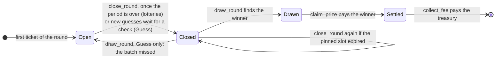

<div align="center">


# S☉Lucky

**Lottery games on Solana: a daily draw, an hourly draw, and a hidden number to hunt down. The winner takes 80% of the pot.**

Every ticket, every lamport of the pot and every draw lives on-chain, where anyone can check it. In 20 languages.

[](https://github.com/nexow-ai/solucky/actions/workflows/ci.yml)
[](LICENSE)


A product of [Nexow, Inc.](https://nexow.studio)

</div>

---

## How it works

S☉Lucky has three **games**. In each, players buy **tickets** at the game's price, each carrying a number from 0 to 21 000 000 (`max_number` in the config, set from `SOLUCKY_MAX_NUMBER`). A number can only be sold once per **round**.

| Game | A round lasts | The winner |
| --- | --- | --- |
| **Daily lottery** | one UTC day | the ticket closest to a random number drawn after midnight |
| **Hourly lottery** | one UTC hour | the ticket closest to a random number drawn after the hour |
| **Guess the number** | until someone finds the number | the guess that hits it |

Every game splits the pot the same way: **80% to the winner**, the game's house fee (at most 20%) out of the rest, and **what is left carries over** to the game's next round drawn. Each game has its own price and fee.



1. **Buy.** `buy_ticket` moves the ticket price from the player to the round account and mixes the purchase into the round's entropy. The first ticket opens the round, which copies the game's price and fee and the config's highest number. The buyer passes the price they were shown and never pays more. A lottery round also keeps its numbers sorted after its fields; the buyer pays the rent of those 4 bytes.
2. **Close.** Once a lottery round is over, anyone can call `close_round`. In Guess, `close_round` seals the guesses not checked yet, any time; sales go on until the pinned slot is produced. Either way it pins a slot 8 slots in the future, whose hash nobody knows yet.
3. **Draw.** Once that slot exists, anyone can call `draw_round`. The program reads the slot's hash from the SlotHashes sysvar and computes `randomness = sha256(entropy ‖ slot_hash ‖ slot ‖ round)`, then `x = u64(randomness[0..8])`.
   - **Lotteries:** the drawn number is `x mod (max_number + 1)`, and the winner is the ticket closest to it (a tie goes to the lower number), found by binary search in the round's sorted numbers.
   - **Guess:** with `checked` guesses already wrong, the number is one of the `R = max_number + 1 − checked` numbers left, and the batch holds `k` of them. If `x mod R < k`, the guess at that position in the batch found it; otherwise those numbers are out and the round goes on. Those are exactly the odds of a number hidden when the round opened: nobody, including the operator, knows it. A hit puts the game's next round on sale at once.
   - When a winner is known, the round takes the game's carry into its pot and splits it: 80% for the winner, the fee, and the rest back to the game's account as the next carry.
4. **Pay.** Anyone can call `claim_prize`. The winner's 80% goes to the winning ticket's owner, and nobody else can receive it. Anyone can then call `collect_fee` to send the fee to the treasury; the two steps are separate so the treasury can never hold up a winner.
5. **Reclaim.** After the payout, players can close their tickets to get the ticket rent back. The round account stays on-chain as the public record of the round.

A bot (the **crank**, `bun run crank`) closes, draws and pays the lottery rounds right after they end, and checks new guesses every few seconds. Any player can do the same from the app. Each step only costs network fees.

## Fairness and trust

| Guarantee | Enforced by |
| --- | --- |
| The pot can only go to the winner, the fee to the treasury and the rest to the game's next round | `draw_round` splits it; `claim_prize` checks the ticket and its owner; `collect_fee` checks the configured treasury |
| The operator cannot withdraw a pot or stop it from being paid | No such instruction exists; pausing only blocks new tickets, and the winner's payout never touches the treasury. The authority can only change where fees go |
| The winner always gets 80%, the fee is at most 20%, and price, fee or range changes never affect a round already selling | `WINNER_SHARE_BPS`, `MAX_FEE_BPS`, and each round copies the price, fee and highest number when it opens |
| A buyer never pays more than the price they saw | `buy_ticket` takes a `max_price` |
| Prizes can always be paid, even to an empty wallet | Tickets cost at least 0.002 SOL, so 80% of a pot is always above the rent-exempt minimum |
| Only the program's upgrade authority can create the config | `initialize` checks the program data account |
| Nobody can pick the Guess outcome by buying at the last moment | Sales stop once the pinned slot exists, sealed guesses are drawn from the entropy they were sealed with, and a re-pinned check keeps the same guesses |
| Anyone can finish a round | `close_round`, `draw_round` and `claim_prize` need no special signer |
| Anyone can check the draw | The round stores the entropy, slot, slot hash, randomness and, for lotteries, its sorted numbers; the app recomputes the winner in the browser |

**Known limits.** This draw is fair against players, not against validators:

- The randomness comes from the hash of a slot pinned a few slots in the future, so nobody can predict it when the round closes. But the slot hash is a bank hash, which depends on the block's contents: the leader of that slot can try different blocks and publish a favourable one, or skip it (leaders produce 4 slots in a row, and the next leader can fork a block out). A validator who also closes the round can aim the pinned slot at its own leader slots.
- Guess runs a draw every few seconds while guesses come in, so a validator gets many more chances to land on a pinned slot than in the lotteries.
- Once the pinned slot exists, anyone can compute the result before drawing. The draw stays possible while SlotHashes still holds that slot (about 512 slots, ~3.5 minutes), and `close_round` only pins a new slot once SlotHashes proves the old one is out of reach. A player who closes a round and dislikes the result could still withhold the draw and hope nobody else draws in time. Run the crank continuously (`bun run crank --watch --interval 10`) so every round is drawn and every guess checked within seconds.
- For real-money pots, replace the draw with a verifiable randomness oracle such as Switchboard On-Demand or ORAO VRF. The draw logic is one function in [`draw_round.rs`](programs/solucky/src/instructions/draw_round.rs).
- An upgradeable program is only as trustworthy as its upgrade authority. Consider a multisig, or making the program immutable once it is stable.

## Repository layout

```
programs/solucky/   Anchor program (Rust), with unit and LiteSVM integration tests
idl/                The program's IDL, committed so the client can be regenerated without Rust
clients/js/         @solucky/client: Codama-generated @solana/kit client plus helpers
app/                Nuxt 4 + Nuxt UI app: landing page, game, round pages, /api/price, /api/geo, in 20 languages (app/i18n)
scripts/            Operator scripts: admin (config), crank (settle rounds), e2e (local end-to-end)
.github/workflows/  CI, and an optional scheduled crank
```

## Requirements

- [Bun](https://bun.sh) 1.2 or later, and Node.js 22.22 or later
- To build the program: [Rust](https://rustup.rs) (the pinned toolchain installs itself), [Anchor](https://www.anchor-lang.com/docs/installation) 1.2.1 (`avm install 1.2.1 && avm use 1.2.1`) and the [Solana CLI](https://docs.anza.xyz/cli/install) (Agave) for `cargo build-sbf`
- To deploy to devnet or mainnet: the Solana CLI **4.x** (tested with 4.3.2; older CLIs cannot deploy SBPF v3 programs)
- To run everything locally: [Surfpool](https://github.com/txtx/surfpool) 1.6 or later. Its cheatcodes load the program without the Solana CLI or a deploy keypair, and move the clock past midnight

## Quick start

```bash
bun install
bun run dev          # http://localhost:3000, against devnet
```

The app talks to the program on the cluster set in `app/.env` (see [`app/.env.example`](app/.env.example)). Until the program is deployed and initialized there, the game shows "The lottery is not set up on this cluster yet".

### Run the whole stack locally

```bash
bun run program:build        # anchor build, copy the IDL, regenerate the client
surfpool start --offline --no-deploy

# in another terminal
export SOLANA_RPC_URL=http://127.0.0.1:8899
bun run localnet --fund <YOUR WALLET ADDRESS>   # load the program, open the games, send you ◎10
bun run e2e                                     # optional: play a round of each game and check every payout
NUXT_PUBLIC_CLUSTER=localnet bun run dev
```

`localnet` and `e2e` only run against a local RPC. They load `target/deploy/solucky.so` at the program address with your keypair (or a throwaway one) as upgrade authority, and open the three games with ◎0.1 tickets, a 5% fee and numbers from 0 to `SOLUCKY_MAX_NUMBER`. Point your wallet at `http://127.0.0.1:8899` to play.

The program address in the code, `GC81vFcGhBvT9poUzXAFqvfZ8rnAqGVmKUPehrXLq6ux` (2.0; 1.0 ran at `8uiVKnUeC7L4KG93MWvfhRoJkprdAUZ3eg3nzzKfowq2`), belongs to a keypair that Nexow keeps out of the repository. On a fresh clone, `anchor build` creates a new `target/deploy/solucky-keypair.json`; run `anchor keys sync` and `bun run program:build` once to switch the code, IDL and client to your own address. Keep that keypair backed up and never commit it.

## Deploying

1. **Program.** Make a [verifiable build](#verifiable-builds), then deploy it with the wallet that should be the upgrade authority:
   ```bash
   bun run program:build:verifiable
   solana program deploy -u devnet --program-id target/deploy/solucky-keypair.json target/verifiable/solucky.so
   ```
2. **Config and games.** Copy [`.env.example`](.env.example) to `.env` and set `SOLUCKY_MAX_NUMBER` (21 000 000 by default). As the upgrade authority, create the config and open the three games at one price and fee (tickets cost at least ◎0.002, the fee is at most 2000 bps). Fund the treasury with at least ◎0.001 first, so it can receive small fees:
   ```bash
   SOLANA_RPC_URL=https://api.devnet.solana.com bun run admin init --treasury <ADDRESS> --price 0.1 --fee-bps 500
   bun run admin game hourly --price 0.01      # each game has its own price and fee
   bun run admin status
   ```
   Later changes: `bun run admin game <daily|hourly|guess> --price <SOL> --fee-bps <n>`, and `bun run admin set --max-number <n>`, `--treasury <ADDRESS>`, `--authority <ADDRESS>`, `--pause`, `--resume`.
3. **App.** `bun run deploy` builds for Cloudflare Workers and deploys with [`app/wrangler.jsonc`](app/wrangler.jsonc). Set the cluster, and preferably a dedicated RPC endpoint, as `NUXT_PUBLIC_*` variables there. `bun run build` produces a Node server in `app/.output` instead. The app installs as a PWA and updates itself: a page left open offers each deploy within ten minutes and loads it on its next page change, and an installed app gets it on its next launch.
4. **Crank.** Run `bun run crank --watch --interval 10` as a service (systemd, a container, a small VM) so lottery rounds are drawn within seconds of their end and Guess players get their check within seconds; it polls every 3 seconds while guesses wait. [`.github/workflows/crank.yml`](.github/workflows/crank.yml) is a backup, since scheduled Actions often start minutes late: enable it with the repository variable `SOLUCKY_CRANK_ENABLED=true`, the variable `SOLANA_RPC_URL` and the secret `SOLANA_KEYPAIR_JSON`. Use a dedicated, lightly funded keypair: the crank never needs authority.
5. **Monitoring.** `bun run monitor --crank <CRANK ADDRESS>` exits with an error when a finished lottery round is still unsettled 15 minutes after it ended, when a Guess winner is still unpaid, or when the crank holds less than ◎0.05; with `ALERT_WEBHOOK_URL` set it also posts to a Slack or Discord webhook. [`.github/workflows/monitor.yml`](.github/workflows/monitor.yml) runs it twice a day once the repository variable `SOLUCKY_MONITOR_ENABLED=true` is set (with the variables `SOLANA_RPC_URL` and `SOLUCKY_CRANK`, and the secret `ALERT_WEBHOOK_URL`); GitHub also emails you when a run fails.

## Verifiable builds

`bun run program:build:verifiable` builds the program inside Anchor's pinned Docker image (`quay.io/ottersec/anchor:v1.2.1`), so the same commit always produces the same bytes, whoever builds it. Deploy `target/verifiable/solucky.so`, not the regular build, so the program on-chain can be traced back to this source.

Every `v*` tag runs the [Release workflow](.github/workflows/release.yml), which makes the same build and attaches `solucky.so`, its SHA-256, its program hash and the IDL to the GitHub release. The program hash ignores the file's trailing zero bytes, as the chain does, so it is the value to compare with a deployment.

To check a deployed program against a commit, rebuild that commit (or download the release's `solucky.so`) and compare hashes with [`solana-verify`](https://github.com/Ellipsis-Labs/solana-verifiable-build):

```bash
git checkout <COMMIT> && bun run program:build:verifiable
solana-verify get-executable-hash target/verifiable/solucky.so
solana-verify get-program-hash -u devnet GC81vFcGhBvT9poUzXAFqvfZ8rnAqGVmKUPehrXLq6ux   # must print the same hash
```

To show the program as verified in Solana explorers, the upgrade authority can publish the check with `solana-verify verify-from-repo --remote`, passing `--base-image quay.io/ottersec/anchor:v1.2.1` so it builds exactly like `program:build:verifiable`.

## Configuration

**App** (`app/.env`, or the host's environment; all public):

| Variable | Default | Meaning |
| --- | --- | --- |
| `NUXT_PUBLIC_CLUSTER` | `devnet` | `mainnet`, `devnet`, `testnet` or `localnet`; also picks the wallet chain |
| `NUXT_PUBLIC_RPC_URL` | public endpoint | RPC endpoint. Use a provider in production: public endpoints are rate-limited |
| `NUXT_PUBLIC_RPC_WS_URL` | from the RPC URL | Websocket endpoint, if different |
| `NUXT_PUBLIC_PROGRAM_ID` | from the IDL | Program address |
| `NUXT_PUBLIC_MAX_NUMBER` | `21000000` | Highest ticket number, shown until the on-chain config loads; keep it equal to `SOLUCKY_MAX_NUMBER` |
| `NUXT_PUBLIC_SITE_URL` | empty | Public URL of the site, for absolute social-card links |
| `NUXT_PUBLIC_I18N_BASE_URL` | empty | The same URL again, for the hreflang and canonical links of every language |
| `NUXT_PUBLIC_TWITTER_URL`, `NUXT_PUBLIC_DISCORD_URL` | empty | Footer links, hidden when empty |

**Scripts** (`admin`, `crank`, `monitor`, `localnet`, `e2e`; a `.env` at the root, see [`.env.example`](.env.example)):

| Variable | Default | Meaning |
| --- | --- | --- |
| `SOLANA_RPC_URL` | devnet | RPC endpoint |
| `SOLANA_KEYPAIR` | `~/.config/solana/id.json` | Signer keypair file |
| `SOLANA_KEYPAIR_JSON` | — | The keypair's byte array, for CI secrets |
| `SOLUCKY_PROGRAM_ID` | from the IDL | Program address |
| `SOLUCKY_MAX_NUMBER` | `21000000` | Highest ticket number in every game, written to the config by `admin init` and `localnet` |
| `ALERT_WEBHOOK_URL` | — | `monitor` only: Slack or Discord webhook for alerts |

## Languages

English, Español, Français, Deutsch, Italiano, Português (Brasil), Nederlands, Türkçe, Русский, Українська, العربية, עברית, हिन्दी, ไทย, Tiếng Việt, Bahasa Indonesia, 简体中文, 繁體中文, 日本語 and 한국어: the same twenty as [beenzer.xyz](https://beenzer.xyz).

- **The list** is [`app/i18n/languages.ts`](app/i18n/languages.ts): each language's path code, its `lang` tag, its name in itself, its direction, and the plural forms its messages give. `nuxt.config.ts` reads it for [@nuxtjs/i18n](https://i18n.nuxtjs.org).
- **The words** are in `app/i18n/locales/`, one file per language. `en.ts` is the source and defines the type every other file must match. `bun run test:js` checks that every dictionary has the same keys and the same `{placeholders}` as English, the right number of plural forms, and valid message syntax, and that it is really translated. Messages follow vue-i18n: `{name}` is a value the page fills in (sometimes a link or bold text, rendered with `<i18n-t>`), and ` | ` separates plural forms. The legal pages are translated too, and each translation says the English version applies.
- **Pages** exist in every language: English at the root (`/play`), the others under their code (`/fr/play`, `/ar/play`, `/zh-cn/play`). Each page has `hreflang` alternates and its own `og:locale`; set `NUXT_PUBLIC_I18N_BASE_URL` so they are absolute.
- **Right to left:** Arabic and Hebrew set `dir="rtl"`, and Nuxt UI's components follow. Layout uses logical properties (`ps-`, `ms-`, `text-end`), arrows along the line of reading flip, and the parts that are clocks or numbers stay left to right: the solar dial, the day bar, the countdown, the reels, the keypad, the pot chart, addresses.
- **Type:** Space Grotesk and JetBrains Mono cover Latin and Vietnamese. Cyrillic, Arabic, Hebrew, Devanagari, Thai, Chinese, Japanese and Korean use the faces their systems ship, so nothing is downloaded from anyone else; those scripts drop the Latin letter-spacing (`main.css`).
- **Numbers:** lottery numbers and SOL amounts look the same in every language (`21 000 000`, `◎0.1`). Dollars, percentages, durations, dates and country names follow the page's language through `Intl`, with Western digits in Arabic and the Gregorian calendar in Thai. Program errors are translated from their codes (`app/utils/errors.ts`).
- **Choosing:** the globe in the header lists every language in its own name, and the footer links them all. Nothing redirects and no cookie is set: a visitor whose browser prefers another of the languages is offered it once, in that language (`AppLangSuggest.vue`), and the choice is kept in local storage (`solucky:lang`, listed on the Cookies & storage page).

To add a language: add it to `LOCALES` with its plural forms, copy `en.ts` to `<code>.ts` and translate it (keep the keys, `{placeholders}` and plural forms), add its Nuxt UI locale in `app/app/app.vue` and its offer in `app/i18n/suggest.ts`. To change copy, change `en.ts` and every other dictionary with it.

## Program reference

| Instruction | Who | What |
| --- | --- | --- |
| `initialize(max_number)` | upgrade authority | Creates the config |
| `update_config(update)` | config authority | Changes the authority, treasury, number range or pause flag |
| `set_game(kind, ticket_price, fee_bps)` | config authority | Opens a game, or changes its price and fee for its next rounds |
| `buy_ticket(kind, period, number, country, max_price)` | any player | Buys `number` in the game's round on sale, at no more than `max_price` |
| `close_round` | anyone | Ends a finished lottery round, or seals a Guess round's new guesses, and pins the draw slot |
| `draw_round` | anyone | Finds the winner (or, in Guess, checks the sealed guesses) and splits the pot |
| `claim_prize` | anyone | Pays the winner their 80% |
| `collect_fee` | anyone | Sends a settled round's fee to the treasury |
| `close_ticket` | ticket owner | Returns a settled round's ticket rent |

Accounts are PDAs: `Config` (`"config"`), `Game` (`"game"`, kind as u8: 0 daily, 1 hourly, 2 guess), `Round` (`"round"`, kind as u8, period as u32 LE) and `Ticket` (`"ticket"`, round, number as u32 LE). A round's period is days (daily) or hours (hourly) since the Unix epoch in UTC, or the Guess round number. `Game` holds the carry for the next round. A lottery `Round` is followed by its sorted numbers, 4 bytes (u32 LE) each, up to `MAX_LOTTERY_TICKETS`. A ticket's country is an ISO 3166-1 alpha-2 code, or two zero bytes when the player keeps it private. Error codes start at 6000; see [`error.rs`](programs/solucky/src/error.rs).

## Development

```bash
bun run program:test   # program unit + LiteSVM integration tests (needs target/deploy/solucky.so)
bun run test:js        # client and app unit tests
bun run test:browser   # Playwright, against a production build on a local Surfpool (see below)
bun run typecheck
bun run lint           # ESLint, and Clippy with warnings as errors
bun run format         # Prettier and rustfmt
bun run check          # everything CI runs, except the program build and the e2e
```

After changing the program, run `bun run program:build`: it rebuilds the program, copies the IDL to `idl/` and regenerates `clients/js/src/generated`. Never edit generated files by hand.

The browser tests drive the real app in Chromium with an injected test wallet: connect, buy a number, settle the daily round after midnight and check the draw, then buy and check a guess, with no Content Security Policy violations allowed. Run them with Surfpool up and `bun run localnet` done, after `bun run build`.

CI runs three jobs on every push: the program (format, build, Clippy, tests, and a check that the committed IDL matches), the client and app (stale generated code, format, types, lint, tests, Node and Cloudflare builds), and an end-to-end job on Surfpool with the program binary the first job built, which plays a round of each game with the scripts and then with the browser.

## Security

Report vulnerabilities privately; see [SECURITY.md](SECURITY.md). Production builds of the app send a strict set of security headers (CSP with no third-party scripts, `frame-ancestors 'none'`, HSTS, and others), defined in [`app/nuxt.config.ts`](app/nuxt.config.ts); on Cloudflare, Nitro writes them to `_headers` so static files carry them too. Before version 1.0.0 this repository contained credentials and a keypair in plain text. They are gone from the code but remain in the git history of this public repository, so treat all of them as compromised.

## Legal

Lotteries and gambling are regulated in most countries. The public app runs on devnet with test SOL. Running S☉Lucky with real money is the operator's responsibility: check the licences you need, restrict access where it is not allowed, and only let adults play.

## License

[MIT](LICENSE) © 2022–2026 Nexow, Inc. · [nexow.studio](https://nexow.studio)
